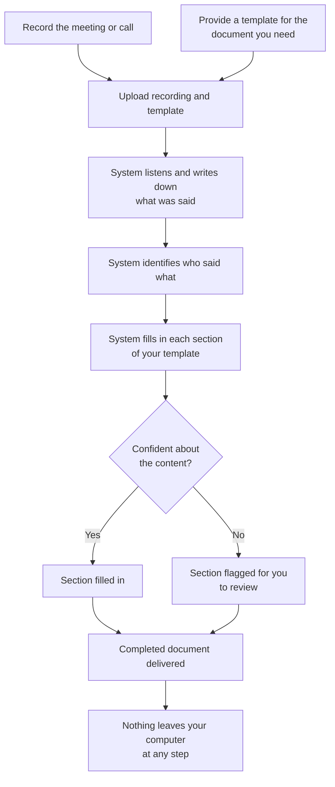

# localscribe

Fully local tool that takes a recorded meeting/call video and a template
file, transcribes the recording on-device, and fills the template's fields
from the transcript — no audio, video, or transcript data ever leaves the
machine.

Not a meeting-minutes generator. It automates the manual step of listening
to a recording and typing its content into a required document format,
for whatever template the situation calls for.

## How it works



## Status

v1 pipeline implemented, pending real-world integration test. The web app
(React + FastAPI) fills the fixed coding-transcript template in
`templates/` with 5-minute interval transcripts. See:
- [PRD](Local%20Meeting%20Summarizer%20-%20PRD.md) — requirements, scope, architecture
- [Design spec](docs/superpowers/specs/2026-08-02-local-transcript-autofill-design.md) — module breakdown, implementation decisions

## Stack

ffmpeg · faster-whisper · pyannote.audio · Ollama (Llama 3.1 8B, CLI only) · FastAPI · React + Vite + Tailwind · uv · Docker

## Run with Docker (recommended)

1. Accept the [pyannote/speaker-diarization-3.1](https://huggingface.co/pyannote/speaker-diarization-3.1)
   license on Hugging Face and create a read token.
2. `cp .env.example .env` and set `HF_TOKEN`.
3. Start it:

```bash
docker compose up --build -d
```

Open http://localhost:8000 (or `http://<this-machine's-LAN-IP>:8000` from
other devices on your network). The first job downloads the Whisper and
pyannote models (a few GB) into the `localscribe-models` volume. Job history
and transcripts live in the `localscribe-data` volume.

- The image uses CPU-only PyTorch by default (about 3 GB smaller). Build with
  `TORCH_VARIANT=default` in `docker-compose.yml` to get the CUDA build from `uv.lock`.
- There is no login. Anyone who can reach the port can see every job. To keep
  it on this machine only, change the port mapping to `127.0.0.1:8000:8000`.

## Run from source

```bash
brew install ffmpeg                         # or: apt install ffmpeg
uv sync --extra dev --extra server
(cd frontend && npm ci && npm run build)    # builds the UI into frontend/dist
export HF_TOKEN=...                         # pyannote gated-model token
uv run localscribe-server                   # http://localhost:8000
```

For frontend development, run `npm run dev` in `frontend/`. It proxies `/api`
to the server on :8000.

To use the field-extraction CLI (any Markdown/DOCX template, filled by the
LLM), you also need a local Ollama install with `llama3.1:8b` pulled:

```bash
uv run python -m tw.cli --video recording.mp4 --template template.md
```

## Web app features

- Drag-and-drop upload of multiple recordings, with upload progress. Jobs run
  one at a time on a shared queue (at most 5 queued or processing).
- **Document preview:** shows the filled .docx as Word-style pages, scaled to
  fit the screen.
- **Edit document:** edit any table cell (transcription fixes, Code, Misc.) on
  the page and save it back into the .docx. Formatting is kept. If someone else
  changed the document since you opened it, the save is refused (no silent
  overwrite). "Revert to original" discards all edits.
- **Reader view:** search the transcript, show or hide speakers, see each
  speaker's share of the words, and copy the text.
- **Speaker names:** rename `SPEAKER_00` and the others to real names. Names
  can be changed again later, and edits made in between are kept.
- The download is always the current (edited and renamed) document.

Configuration (environment variables): `HF_TOKEN`, `LOCALSCRIBE_DATA_DIR`,
`LOCALSCRIBE_TEMPLATE`, `LOCALSCRIBE_STATIC_DIR`, `LOCALSCRIBE_HOST`,
`LOCALSCRIBE_PORT`, `LOCALSCRIBE_MAX_ACTIVE_JOBS`, `LOCALSCRIBE_MAX_UPLOAD_MB`,
`LOCALSCRIBE_INTERVAL_MINUTES`.

---

# localscribe Blueprint

## System Overview

A single-process web app plus an offline pipeline. The browser UI (`frontend/`,
React) talks to a FastAPI server (`tw.server`). The server streams uploads to
disk and queues them on one in-process `JobQueue` with a single worker thread.
The worker runs `tw.interval_transcript.run`:

ffmpeg → faster-whisper → pyannote → `align` → `bucket_by_interval` → `fill_interval_table`

The result is a filled DOCX. The pristine output is kept. Speaker renames and
cell edits are applied to a per-job working copy, which is what users preview
and download. `tw.pipeline` and `tw.cli` are a separate, LLM-based path for
filling arbitrary templates, and the web app does not use them.

## Local Interface & Invariants

- `Dockerfile` / `docker-compose.yml`: multi-stage image (Node builds `frontend/dist`, Python runtime with ffmpeg), served by `localscribe-server` on port 8000. Volumes: `/data` (jobs, outputs, uploads, temp files) and `/models` (Hugging Face and Whisper caches).
- `pyproject.toml`: extras `dev`, `eval`, `server`. Script `localscribe-server = tw.server:main`.
- `templates/coding_transcription_template.docx`: the fixed template. Its first table must have a `Transcription` header column and `Int N` rows.

## Subdirectories & System Boundaries

- src: [./src/README.md](./src/README.md) - the `tw` Python package: pipeline, job queue, HTTP API, DOCX preview and editing.
- eval: [./eval/README.md](./eval/README.md) - offline WER/DER (AMI) and extraction-quality (QMSum) evaluation scripts.
- frontend: React + Vite + Tailwind single-page UI (`src/App.tsx`, `src/components/*`). It calls only `/api/*` endpoints of `tw.server`.

## Global Invariants

- Nothing is sent off the machine except model downloads from Hugging Face. Recordings are deleted after their job finishes.
- Transcript turns use the format `[HH:MM:SS] [speaker] text`, separated by blank lines. `align.format_transcript` writes it. `transcript_preview`, `speaker_rename` and the UI parse it. Speaker names may not contain `[` or `]`.
- Only one job is processed at a time, and at most `LOCALSCRIBE_MAX_ACTIVE_JOBS` can be queued or processing.
- `Job.output_path` is never modified after a job completes. All user changes go to `Job.working_output_path`.

## Global Side Effects

- Disk under `LOCALSCRIBE_DATA_DIR`: `job_queue_data/jobs.json` (atomic rewrite), `outputs/<job>_*.docx`, `uploads/job_*` (per-job scratch, removed after each job and at startup).
- Model caches (`HF_HOME`) and the `pyannote/speaker-diarization-3.1` gated download, which needs `HF_TOKEN`.
- Subprocess `ffmpeg` per job. ML models stay loaded while jobs are queued and are released when the queue goes idle.

## System Verification

- Run: `uv run pytest`
- Run: `cd frontend && npm run build && npx eslint src`
